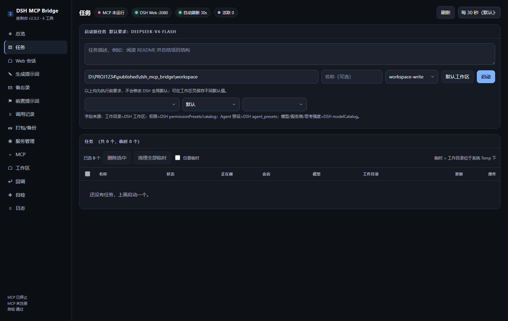
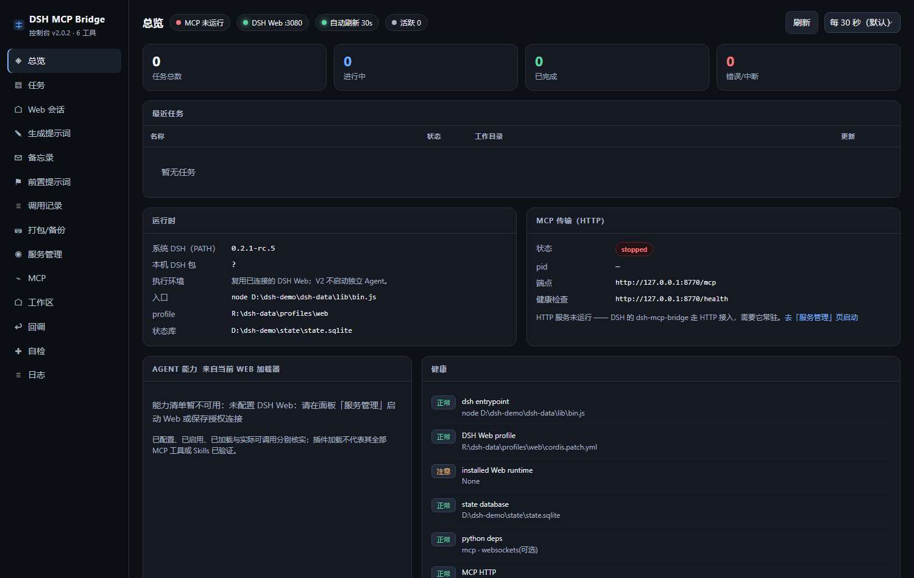
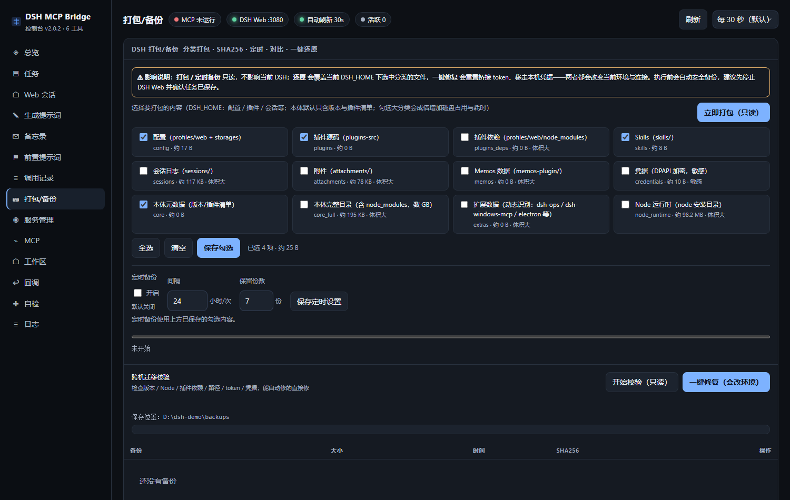
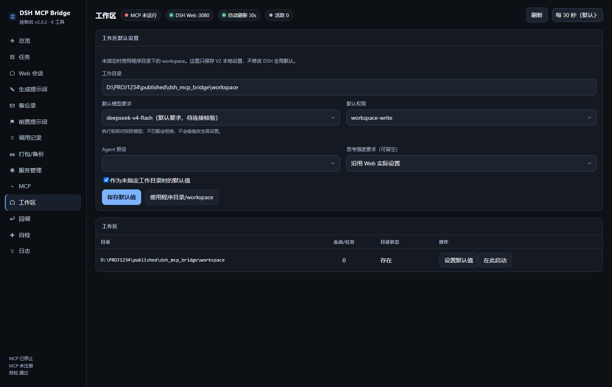

# DSH MCP Bridge

**中文** | [English](#english)

把 **DeepSeek Harness（DSH）** 的运行时通过 **MCP（Model Context Protocol）** 暴露给任意 AI 客户端，并附带一个本地控制面板：创建任务、跟踪进度、读取会话、发消息、备份与跨机迁移。

> 复用 DSH 已有的 Web Runtime 与数据，不模拟页面点击，不维护第二套 Agent / Profile 配置。



---

## 1. 为什么需要它

DSH 本身的 Web UI 很好用，但：

- **其他 AI 客户端**（Claude Desktop、Cursor、自研 Agent）无法直接操作 DSH；
- 长时间运行的任务需要**跨会话跟踪状态、进度、结果**；
- 会话历史、附件、排队/插话能力没有标准接口；
- 换机器或重装时，DSH 配置、插件、会话难以**可校验地备份和迁移**。

DSH MCP Bridge 通过 DSH 自带的 Web RPC 完成上述事情，对外只暴露 6 组 MCP 工具 + 一个控制面板。

## 2. 架构

```
┌────────────────────┐       MCP (HTTP)        ┌─────────────────────────┐
│ Claude / Cursor /  │ ──────────────────────▶ │  DSH MCP Bridge         │
│ 自研 Agent         │  Bearer Token           │  ├─ MCP Server  :8770   │
└────────────────────┘                         │  ├─ Control Panel :8765 │
                                               │  └─ DSH Web RPC client  │
┌────────────────────┐        HTTP             │                         │
│ 浏览器（面板）      │ ──────────────────────▶ │                         │
└────────────────────┘                         └───────────┬─────────────┘
                                                           │ 原生 Web API
                                                ┌──────────▼─────────────┐
                                                │ DSH Web Runtime :3080  │
                                                │ 会话 / 任务 / 插件      │
                                                └────────────────────────┘
```

- **MCP Server**：Streamable HTTP，默认 `http://127.0.0.1:8770/mcp`
- **控制面板**：默认 `http://127.0.0.1:8765`
- **DSH Web**：默认 `http://127.0.0.1:3080`（可配置）
- 桥接自身的数据（状态库、Token、凭据）默认在项目内 `data/`

## 3. 功能总览

### 3.1 控制面板

| 页面 | 能力 |
| --- | --- |
| 总览 | 运行状态、任务/会话统计、快速入口 |
| 任务 | 启动任务、状态/活动、最终答案、排队与中断、批量清理 |
| Web 会话 | 浏览/搜索/恢复/关闭 DSH 原生会话，查看历史 |
| 生成提示词 | 前置约束/权限模板生成、预览、复制 |
| 备忘录 | 可复用文本片段 |
| 前置提示词 | 默认系统前置约束管理 |
| 调用记录 | 面板与 MCP 调用日志（成功/失败、耗时、来源） |
| 打包/备份 | 分类备份、sha256、对比、还原、定时备份、跨机校验 |
| 服务管理 | 启动/停止 DSH Web 与 MCP 服务、端口与进程状态 |
| MCP | 工具清单、Token、连接示例 |
| 工作区 | 每个工作区的默认权限/预设/模型/思考强度 |
| 回调 | 回调地址与投递记录 |
| 自检 | 环境诊断（Python、DSH、端口、权限） |
| 日志 | 运行日志查看 |

### 3.2 MCP 工具

| 工具 | 主要 actions |
| --- | --- |
| `dsh_session` | create / list / search / detail / resume / attach / rename / close / cancel / fork / pin / unpin / archive / unarchive / queue_edit / queue_remove / queue_steer / interactions / interaction_reply |
| `dsh_task` | submit / list / status / wait / result / interrupt / close / release / watch / unwatch / reconnect |
| `dsh_message` | send（文本/图片/文件）/ history / upload / attachment |
| `dsh_runtime` | status / models / capabilities / control / jobs / skills / options |
| `dsh_event` | 事件增量（after、progress、tools） |
| `dsh_workspace` | list / create / rename / delete / defaults |

> 参数路由：每个工具只需传 `action` + 对应参数，schema 在连接时自动注册。

## 4. 界面截图

**总览：运行状态与快捷入口**



**任务页：启动任务、查看状态与活动**


**打包/备份：分类勾选、进度、sha256、对比、还原、跨机校验**



**工作区：默认权限/预设/模型/思考强度**



## 5. 适用场景

1. **把 DSH 接进 Claude Desktop / Cursor**：直接让 AI 创建任务、查进度、读结果。
2. **外部编排器驱动 DSH**：自研 Agent 用 MCP 提交任务、轮询状态、拿最终答案。
3. **长任务跟踪**：任务跑几十分钟甚至更久，随时查状态、活动、事件。
4. **会话复用**：读取历史、继续已有会话、下载附件。
5. **团队/多工作区管理**：为不同项目设置默认权限、预设、模型。
6. **可校验备份与迁移**：按分类打包、sha256 校验、换机还原并体检。

## 6. 工作原理

- 通过 `session/*` 等原生 Web RPC 读写 DSH，**不模拟浏览器点击**。
- 对需要观察的会话附加 bridge observer，队列/插话、事件流都来自 DSH 本身。
- 权限映射使用 DSH 的 `permissionPresets/catalog`（`read-only` / `workspace-write` / `danger-full-access` / `auto`），非法值直接拒绝。
- 模型、思考强度、Agent 预设均从 DSH 实时目录读取（`session/modelCatalog`、`agent_presets`）。

## 7. 环境要求

- **Python 3.10+**
- **DeepSeek Harness（DSH）** 已安装，Web UI 可访问（默认 3080）
- **Node.js**（DSH 运行依赖）
- 可选：`zstandard`（读取会话日志）

## 8. 安装与启动

```bash
git clone <your-repo-url>
cd dsh_mcp_bridge
python -m pip install -r requirements.txt

# 启动面板（默认同时启动 MCP 服务）
python main.py panel --port 8765 --http-port 8770
```

Windows 也可双击 `start-panel.bat`。

打开 <http://127.0.0.1:8765>，在「服务管理」启动/连接 DSH Web。

## 9. 接入 MCP 客户端

Token 在 `data/state/http.token`（或启动时 `--token` 指定）：

```json
{
  "mcpServers": {
    "dsh-mcp-bridge": {
      "type": "http",
      "url": "http://127.0.0.1:8770/mcp",
      "headers": { "Authorization": "Bearer <token>" }
    }
  }
}
```

- **Claude Desktop**：设置 → 开发者 → 编辑配置，加入上面的 JSON。
- **Cursor**：Settings → MCP → Add new MCP server（HTTP 类型）。
- 其他客户端按各自文档填写 `url` / `headers`。

## 10. 典型调用示例

```text
1) dsh_task     action=submit  task="阅读 README 并总结"  cwd="D:\work\repo"
   → 返回 task_id

2) dsh_task     action=status  task_id=...
   → running / 进度 / 最后事件

3) dsh_task     action=wait    task_id=...  seconds=120
4) dsh_task     action=result  task_id=...
   → 最终答案

5) dsh_message  action=send    session_id=...  text="继续，补充测试"
6) dsh_message  action=history session_id=...  max_messages=50
7) dsh_event    task_id=...    after=0  progress=true  tools=true
```

## 11. 配置

| 环境变量 | 说明 | 默认值 |
| --- | --- | --- |
| `DSH_HOME` | DSH 数据目录 | `~/.dsh` |
| `DSH_INSTALL_ROOT` | DSH 安装目录 | 自动探测 `dsh` |
| `DSH_SUBAGENT_STATE` | 桥接状态目录（DB/Token/凭据） | `<项目>/data/state` |
| `DSH_SUBAGENT_DATA` | 桥接数据根目录 | `<项目>/data` |
| `DSH_MCP_HTTP_PORT` | MCP HTTP 端口 | `8770` |
| `DSH_WEB_PORT` | DSH Web 端口 | `3080` |
| `DSH_BACKUP_DIR` | 备份输出目录 | `<项目>/data/backups` |
| `DSH_BACKUP_SCHEDULER` | `0` 关闭定时备份线程 | 开启（定时备份本身默认关闭） |
| `DSH_PANEL_TOKEN` | 面板非回环访问所需 Token | 空（仅回环） |

## 12. 备份与跨机迁移

**备份分类**：配置、插件源码、插件依赖、Skills、会话、附件、Memos、凭据、本体元数据、本体完整目录、扩展数据（动态识别）、Node 运行时。

- 每个备份包含 `manifest.json`（文件列表 + 大小 + sha256）与 `.sha256` 边车
- 支持「对比」：逐文件列出改动/缺失/多出（含哈希前缀）
- 支持「还原」：先自动生成安全备份，再按分类覆盖
- 定时备份默认**关闭**，可在面板开启并设置间隔/保留份数/内容

**跨机迁移**

1. 新机器安装同版本 DSH 与 Node
2. 还原时填写目标 `DSH_HOME`，勾选「路径重写」
3. 还原后自动「跨机校验」：版本、Node、插件依赖、目录、token、注册、凭据
4. 可自动修复：建目录、重置桥接 token、移走换机不可解密的 DPAPI 凭据
5. 剩余项按提示执行（如 `npm i -g @deepseek-ai/dsh@<版本>`）

## 13. 安全模型

- 默认只监听 `127.0.0.1`；面板非回环访问需 `DSH_PANEL_TOKEN`
- MCP 使用 Bearer Token（`data/state/http.token`）
- 凭据用 Windows DPAPI 加密保存；**跨机不可解密**，需重新授权
- `danger-full-access` / `auto` 会显著扩大执行边界，请谨慎授予
- 备份可能包含敏感配置，请妥善保管，勿提交到版本库

## 14. 常见问题

**Q：面板打不开 / MCP 连接被拒？**  
确认服务在跑：`python main.py http status`；端口未被占用；DSH Web 已启动。

**Q：Token 不匹配？**  
读取 `data/state/http.token` 更新客户端；或在面板「MCP」页查看当前 Token。

**Q：任务一直“运行中”？**  
看任务详情的最后事件与活动时间；长时间无更新可能是真实卡住，可中断后重试。

**Q：备份很慢？**  
全选约数 GB、十几万文件，扫描与哈希需要时间；面板有扫描/打包进度，可离开页面。

**Q：换机后凭据失效？**  
正常：DPAPI 绑定本机。用「一键修复」移走旧凭据，再粘贴新的 DSH Web 启动链接。

## 15. 项目结构

```
dsh_mcp_bridge/
├─ main.py                 # 入口：panel / http / doctor
├─ pyproject.toml          # 依赖与命令行入口
├─ requirements.txt
├─ libs/
│  ├─ core/                # 配置、策略、备份、迁移、密钥
│  ├─ transports/          # MCP Server、HTTP、DSH Web RPC
│  ├─ ui/                  # 控制面板（Flask + 前端）
│  └─ resources/           # 内置 Skills
├─ docs/screenshots/       # README 截图
├─ README.md  LICENSE  SECURITY.md  .gitignore
```

> 本发布包**不包含**开发期测试与内部文档。

## 16. 贡献

欢迎 Issue / PR。请保持「复用 DSH Web RPC、不模拟点击」的设计边界，新增能力附带说明与最小复现。

## 17. 许可证

**PolyForm Noncommercial License 1.0.0**：允许个人学习、研究、试验与非商业组织使用；**禁止任何商业用途**。商业授权请联系作者。完整条款见 [LICENSE](LICENSE)。

## 18. 免责声明

独立第三方项目，与 DeepSeek / DeepSeek Harness 官方无关。使用前请自行评估权限与数据安全风险。

---

## English

**MCP bridge for DeepSeek Harness (DSH)** — expose DSH sessions, tasks and runtime to any MCP-capable AI client, with a local control panel for tasks, sessions, backups and migration.

> Reuses the existing DSH Web Runtime and data. No page-click simulation, no second set of agents/profiles.


### 1. Why

- Other AI clients (Claude Desktop, Cursor, custom agents) cannot operate DSH directly.
- Long-running tasks need cross-session status/progress tracking.
- Session history, attachments, queue/steer and events have no standard interface.
- Backups and cross-machine migration need verifiable packaging.

### 2. Architecture

```
MCP client ──HTTP+Bearer──▶ Bridge MCP server :8770 ──┐
Browser    ──HTTP────────▶ Control panel  :8765 ──┼──▶ DSH Web Runtime :3080
                                                     └── native Web RPC
```

### 3. Features

**Panel pages**: overview, tasks, Web sessions, prompt generator, memos, preamble, call log, backup/restore, services, MCP, workspaces, callbacks, self-check, logs.

**MCP tools**: `dsh_session`, `dsh_task`, `dsh_message`, `dsh_runtime`, `dsh_event`, `dsh_workspace` — each routed by `action`.

**Backup**: category-based archive, `manifest.json` + sha256, compare, restore with safety backup, optional schedule (off by default), cross-machine verification/fix.

### 4. Screenshots

**Overview**


**Tasks**


**Backup & restore**


**Workspaces**


### 5. Use cases

1. Connect DSH to Claude Desktop / Cursor.
2. External orchestrators submit and monitor DSH tasks.
3. Track long-running jobs (status, activity, events).
4. Reuse sessions, read history, download attachments.
5. Manage per-workspace defaults (permission, preset, model, effort).
6. Verifiable backups and migration between machines.

### 6. How it works

- Uses native `session/*` Web RPCs — no browser automation.
- Attaches a bridge observer for sessions that need streaming/queue.
- Permission presets come from `permissionPresets/catalog`; invalid values are rejected.
- Models, effort levels and agent presets are read live from DSH catalogs.

### 7. Requirements

- Python 3.10+
- A working DSH installation with Web UI (default `http://127.0.0.1:3080`)
- Node.js
- Optional: `zstandard`

### 8. Install & run

```bash
git clone <your-repo-url>
cd dsh_mcp_bridge
python -m pip install -r requirements.txt
python main.py panel --port 8765 --http-port 8770
```

Open <http://127.0.0.1:8765> and start/connect DSH Web under **Services**.

### 9. MCP client setup

```json
{
  "mcpServers": {
    "dsh-mcp-bridge": {
      "type": "http",
      "url": "http://127.0.0.1:8770/mcp",
      "headers": { "Authorization": "Bearer <data/state/http.token>" }
    }
  }
}
```

### 10. Example flow

```text
dsh_task     submit  task="Summarize README" cwd="D:\work\repo"
dsh_task     status  task_id=...
dsh_task     wait    task_id=... seconds=120
dsh_task     result  task_id=...
dsh_message  send    session_id=... text="Continue"
dsh_message  history session_id=... max_messages=50
dsh_event    task_id=... after=0 progress=true tools=true
```

### 11. Configuration

| Variable | Meaning | Default |
| --- | --- | --- |
| `DSH_HOME` | DSH data directory | `~/.dsh` |
| `DSH_INSTALL_ROOT` | DSH install directory | auto-detect `dsh` |
| `DSH_SUBAGENT_STATE` | Bridge state (DB/token/credentials) | `<project>/data/state` |
| `DSH_SUBAGENT_DATA` | Bridge data root | `<project>/data` |
| `DSH_MCP_HTTP_PORT` | MCP HTTP port | `8770` |
| `DSH_WEB_PORT` | DSH Web port | `3080` |
| `DSH_BACKUP_DIR` | Backup output directory | `<project>/data/backups` |
| `DSH_BACKUP_SCHEDULER` | `0` disables scheduler thread | enabled (schedule itself off) |
| `DSH_PANEL_TOKEN` | Required for non-loopback panel | empty (loopback only) |

### 12. Backup & migration

- Categories: config, plugins, plugin dependencies, skills, sessions, attachments, memos, credentials, core metadata, full core, dynamic extras, Node runtime.
- Each archive has `manifest.json` and a `.sha256` sidecar.
- Compare shows changed/missing/extra files with hash prefixes.
- Restore creates a safety backup first; cross-machine restore supports target path + path rewrite.
- Post-restore verification checks versions, Node, plugin deps, paths, token, registration and credentials; safe fixes are one click.

### 13. Security

Loopback-only by default; Bearer token for MCP; DPAPI-encrypted credentials (not portable); `danger-full-access`/`auto` broaden execution scope; backups may contain secrets.

### 14. FAQ

- **Panel/MCP unreachable**: check `python main.py http status`, ports, and that DSH Web is running.
- **Token mismatch**: read `data/state/http.token` and update the client.
- **Task appears stuck**: inspect last event/activity; interrupt if truly idle.
- **Backup is slow**: hundreds of thousands of files take time; progress is shown.
- **Credentials invalid after moving machines**: expected with DPAPI; use the fixer and re-authorize.

### 15. Project layout

```
main.py, pyproject.toml, requirements.txt
libs/{core,transports,ui,resources}
docs/screenshots/
README.md, LICENSE, SECURITY.md, .gitignore
```

> Development tests and internal docs are not included in this release.

### 16. Contributing

Issues and PRs are welcome. Keep the design boundary: reuse DSH Web RPCs, do not simulate page clicks.

### 17. License

**PolyForm Noncommercial License 1.0.0** — free for personal, research and noncommercial use. **Commercial use is not permitted.** See [LICENSE](LICENSE).

### 18. Disclaimer

Independent third-party project, not affiliated with DeepSeek or DeepSeek Harness.